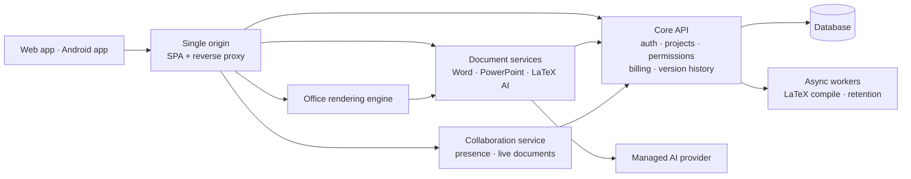

# Scriptor — Product Case Study

**Your ultimate workspace for writing, research, knowledge, creativity and ideation.**
Create, convert, and connect your work — all in one AI-powered workspace.

> Source material for a case study page on big-matrix.com. Technical claims are verified against the product. `[[FILL IN]]` marks business data that has to come from you. Section 12 has ready-to-publish copy; section 13 is a pre-publish checklist.

---

## 1. Snapshot

| | |
|---|---|
| **Product** | Scriptor — [scriptor.space](https://scriptor.space) |
| **Category** | AI-powered document workspace for technical and academic writing |
| **Users** | Students, researchers, academics, technical writers, engineering teams |
| **Status** | Live in production. Web app + Android app (iOS in progress) |
| **Formats in one workspace** | LaTeX · Word · PowerPoint · Markdown · PDF · Whiteboard · Knowledge graph |
| **Template catalog** | 6,000+ LaTeX, Word and PowerPoint templates across 12 categories |
| **Built in** | ~5 months to production · 434 commits · ~196,000 lines of code |
| **Team** | [[FILL IN — team size and roles]] |

---

## 2. The problem

Technical and academic writing is spread across tools that do not talk to each other. The paper is written in one editor, the report in another, the deck in a third, the notes in a fourth, the diagrams in a fifth, and reviewer PDFs in a sixth. Every handoff loses context.

The cost is not the window-switching. It is that a project's *state* — who can access it, what changed, what it used to say — lives in six systems with six different answers. There is no single version history, no single collaborator list, no single permission model.

LaTeX makes it worse for newcomers. A document fails because a package is not installed. It fails again on a font. Then it compiles, but every citation renders as `[?]` because the toolchain needed three passes and ran one. Existing tools print the raw log and leave the user to decode it.

And most AI writing tools do not touch the document. They produce text in a chat window that the user copies out by hand — close to useless for structured formats, where the real work is *structural*: add a column to this table, insert a section matching the surrounding style, fix the compile error.

---

## 3. What Scriptor does

**Every tool you need. Zero tab-switching.** One project holds a LaTeX manuscript, its Word cover letter, the PowerPoint of its results, linked Markdown notes, whiteboards and annotated PDFs — under one folder tree, one collaborator list, and one version history.

The nine headline capabilities:

| | Capability | What it is |
|---|---|---|
| 01 | **Pro-level LaTeX editor** | Full LaTeX authoring in the browser. Upload existing projects, compile in real time, choose from thousands of templates for papers, theses and CVs |
| 02 | **Word document editor** | Create and edit `.docx` with live preview. Start from report, letter or recipe templates; download as Word or PDF |
| 03 | **PowerPoint editor** | Slide editing from blank or pitch-deck templates, with AI-assisted refinement |
| 04 | **AI writing assistant** | Context-aware chat that rewrites, restructures and expands Word, PowerPoint and LaTeX content, applying changes directly to the file |
| 05 | **Real-time Markdown** | Live rendered preview as you type, with GitHub-flavoured Markdown, math blocks, syntax highlighting and custom themes |
| 06 | **Whiteboarding** | Infinite canvas or paged mode for structured visual notes and presentations |
| 07 | **PDF annotation** | Open any PDF and annotate it with a drawing overlay; the source file is never modified |
| 08 | **Knowledge graph** | Interactive map of the connections between notes, documents and projects |
| 09 | **Full version history** | Every save versioned automatically, including AI edits, with per-author change highlighting and one-click restore |

**The workspace shell** ties them together: split-view editing with draggable panels, browser-like multi-project tabs, tag-based organisation, a command palette, and workspace-wide search.

---

## 4. Word and PowerPoint, in the browser

This is the capability that turns Scriptor from a technical writing tool into a general document workspace, and it was the largest single addition to the platform.

`.docx` and `.pptx` files open in a dedicated workspace with a **live, fully interactive office editing surface** — real formatting, real tables, real slide layouts — rendered server-side and driven from the browser. Changes sync back into the Scriptor project automatically, so an office file is a first-class member of the folder tree rather than an attachment.

What ships with it:

- **Templates to start from** — report, letter and recipe layouts for Word; blank and pitch-deck for PowerPoint. Or upload your own `.docx` / `.pptx`.
- **Export in place** — download as Word, PowerPoint, RTF or PDF without leaving the workspace.
- **A dedicated AI agent per format** with structural editing tools (see §6).
- **Reference attachments** — attach PDFs or Word files to a chat turn to give the AI extra context.
- **Automatic preview refresh** after every AI edit.
- **Live multi-user sessions** — see §5.
- **Version history** — office edits are captured as project versions like everything else.

Delivering this meant building a document-session service, a file-serving protocol layer so the editing surface can read and write project files under Scriptor's own permissions, and a conflict guard for the case where the AI agent and a live editing session write to the same file at the same moment (§7.2).

---

## 5. Real-time collaboration, on every surface

**Share securely. Work together.** Invite by email as **viewer** or **editor**; share a whole project, a folder, or a single file.

Live co-editing works across all three editing surfaces, not just one:

| Surface | What collaborators see |
|---|---|
| **Code editor** — Markdown, LaTeX, plain text | Coloured live carets with names and avatars; concurrent typing in the same paragraph merges cleanly instead of overwriting |
| **Word** | Shared live session — edits and cursors are live in the document |
| **PowerPoint** | Shared live session — edits and cursors are live in the deck |

Supporting behaviour:

- **Every cursor has a name.** Collaborators appear as named, coloured carets in the document *and* in the file tree, so you can see who is working where.
- **Nobody's edits get lost.** Concurrent edits converge rather than last-write-wins.
- **Reviewers stay reviewers.** Read-only collaborators follow along live and can still compile and export, without changing a word — enforced independently at every layer, not just hidden in the UI.
- **Consistent identity colours.** The colour a collaborator's caret gets is the same colour their changes get in version history, so the person in your cursor list and the person in your diff match.
- **In-app invitations** with inline accept/decline, plus push notifications on mobile.

---

## 6. AI that edits your documents — not just chat

Every plan includes credit-based AI access, starting free with 100 credits.

The assistant is a **tool-calling agent**, not a text generator. It has structural editing tools for each format and applies changes directly to the file:

| Format | Example prompt | What the agent actually does |
|---|---|---|
| **LaTeX** | "Resolve the compilation errors and update every figure reference." | Reads the whole multi-file project, edits any file or the preamble, **compiles the project itself**, and iterates until it builds |
| **Word** | "Expand the findings section and turn the comparison into a table." | Fills named sections, creates and populates tables, inserts sections that clone the surrounding style, manages headers, footers, comments, footnotes and images |
| **PowerPoint** | "Add a summary slide and tighten the bullets across this deck." | Adds and deletes slides, rewrites bullet lists, sets shape text and backgrounds, restructures decks |

**79 structural editing tools** across the three agents. Three details worth calling out:

- **It verifies its own work.** If the agent claims it finished without a single editing tool having run, the reply is retracted and it is required to use tools. After editing, it must re-read the document and confirm the change landed before it is allowed to say "done".
- **It can see the result.** The agent renders a page of the compiled or converted document to an image and looks at it, so it judges its own layout rather than trusting the markup was right.
- **It cannot thrash.** Identical repeated tool calls are rejected, and after any failed lookup the agent must re-read the document before it is allowed to modify anything.

Cost is metered per turn against a transactional credit ledger, with monthly grants and optional one-time top-ups.

---

## 7. Engineering highlights

Four problems that took real work. Each is a good candidate for an expandable card.

### 7.1 A LaTeX compiler that repairs its own environment

Compilation is a state machine with three recovery stages, narrated into a log the user can actually read.

- **Engine auto-detection** from the document itself — magic comments, the document class, font packages, CJK commands and source encoding decide between pdfLaTeX, XeLaTeX, LuaLaTeX and the build wrapper.
- **Missing packages install themselves.** The failure is parsed out of the log, the owning package resolved from the distribution's own index, installed, the filename database refreshed, and the compile retried.
- **Missing fonts install themselves, then degrade gracefully.** If a font package cannot be installed, the source is rewritten to safe equivalents so the document renders with the wrong font rather than not rendering at all.
- **Bibliography-aware multi-pass.** After the first pass the auxiliary file is inspected to choose the right bibliography processor, then compilation continues while LaTeX keeps asking for a rerun.

The detail that best shows the depth: TeX wraps log lines at ~79 columns and **breaks them mid-word**, so `Rerun to get citations correct.` can arrive split across lines and a naive match misses it — costing a pass and leaving every citation unresolved. Detection checks literal hints, the same hints against a whitespace-stripped copy of the log, and a catch-all pattern, with a dedicated regression test.

### 7.2 Keeping a live office session and an AI agent from overwriting each other

A user has a Word file open and asks the AI to add a section. The agent rewrites the file. The live editing session is still holding its own in-memory copy, and its next autosave will push that stale copy back over the agent's work.

The fix is an edit guard: for 90 seconds after a turn in which the agent modified the file, incoming saves from the live session are acknowledged as successful but their contents discarded. The session sees a clean save and reloads; the AI's edit survives.

### 7.3 Real-time editing that cannot duplicate a file

Two people open the same file at the same moment. If each client seeds its own shared document from stored content, a conflict-free merge correctly keeps *both* insertions — and the file now contains itself twice.

Scriptor runs an authoritative document room per file. It seeds exactly once, from the database, while holding a lock, so no number of simultaneous joins can seed twice. Writes back to storage are debounced after typing stops and force-flushed on a ceiling and on teardown, and a repetition guard refuses to persist content that is a verbatim repetition of what was last stored — because the database is the only irreversible surface in the system.

On the client, the editor stays read-only for the few hundred milliseconds between opening the connection and receiving the document, because a keystroke in that window would be silently discarded. Connection and sync have deliberately separate timeouts: a short one so an unreachable service falls back to normal autosave and keeps the file *editable*, and a generous one so a large document that is transferring fine is not abandoned for the same reason.

### 7.4 Version history that cannot break saving

Every save from any surface — the editor, mobile, the Word workspace, the PowerPoint workspace, the AI assistant, a restore — becomes exactly one attributed project version. Rapid autosaves coalesce into one readable timeline entry. Storage is patch-based with periodic manifests, so history never counts against a user's storage quota.

The invariant that matters: **a failure inside history never fails the user's save.** It is logged and surfaced as a degraded indicator, never raised. That is a pattern across the platform — auxiliary systems degrade instead of breaking the user's work:

| Subsystem | On failure |
|---|---|
| Rate limiting | Fails open |
| Version capture | Logged; the save still commits |
| AI credit metering | Fails open; the turn proceeds |
| A missing figure at compile time | Compiles anyway, so LaTeX can report the absent graphic |
| Live collaboration service down | Falls back to normal autosave; the file stays editable |
| Cache unavailable | Automatic in-memory fallback |

---

## 8. Architecture in brief

Three principles:

**One system of record.** The core API owns users, projects, files, permissions, billing and version history. It is the only component that can authorise anything.

**Specialised services for what a request/response API cannot do** — long-lived connections, AI turns that stream for minutes, document format manipulation, office session hosting. None of them has a database. None can authorise a request on its own; each verifies a short-lived signed token issued by the core API, carrying the user, the resource, and whether that user may edit it. A read-only collaborator's token says so, and every service enforces it independently.

**Everything is same-origin.** A single reverse proxy serves the app and fronts every service, so the browser never makes a cross-origin request and sessions work without special cases.

The stack composes by profile, so it scales from a 5-container development stack to the full 10-container production deployment, deployed behind a zero-trust edge tunnel with no inbound ports open.

---

## 9. By the numbers

| Code | |
|---|---|
| Total application code | ~196,000 lines / 938 files |
| Backend API | 42,700 lines |
| Document & collaboration services | 17,700 lines |
| Web frontend | 101,900 lines |
| Mobile app | 34,100 lines |

| System | |
|---|---|
| Backend modules | 15 |
| Data models | 34 |
| API endpoints | 107 |
| Backend services | 4 |
| Production containers | 10 |
| AI editing tools | 79 across 3 agents |
| Real-time channels | 6 |
| Commits / build time | 434 / ~5 months to production |

| Testing | |
|---|---|
| Backend test files | 58 (~16,100 lines) |
| Frontend test files | 12 |
| Approach | Property-based testing on the version-history invariants and core state machines, alongside example-based tests |

**Engineering process:** larger subsystems were built from formal written specs before implementation. The version-history spec is 294 lines of numbered requirements plus a 638-line design document — and those requirement numbers are cited *in the source code*, so the reason a given line exists is discoverable from the code itself.

**Business metrics** — `[[FILL IN: registered users, MAU, paid conversion, documents created, LaTeX compiles run, AI turns served, MRR, retention]]`

---

## 10. Plans

| | Free | Pro | Pro Plus |
|---|---|---|---|
| AI credits / month | 100 | 500 | 1,000 |
| LaTeX compiles / day | 30 | 100 | 200 |
| Compile timeout | 500 s | 700 s | 900 s |
| Live office sessions | 1 | 3 | 5 |
| Storage | 5 GB | 25 GB | 50 GB |
| Version history retention | 1 day | 15 days | 30 days |

One-time AI credit top-ups on any plan: 500 credits / $5, 2,000 credits / $20.

---

## 11. Technology

**Frontend** — React, TypeScript, Vite, Tailwind CSS
**Backend** — Python, Django, Django REST Framework, async task workers, Redis, PostgreSQL / SQLite
**Document services** — Python, FastAPI, WebSockets
**Mobile** — React Native, on Google Play
**AI** — a managed frontier language model with agentic tool-calling, prompt caching and vision
**LaTeX** — a full TeX distribution with pdfLaTeX, XeLaTeX and LuaLaTeX engines, bibliography processing and source↔PDF navigation
**Infrastructure** — Docker, profile-based composition, single-origin reverse proxy, zero-trust edge tunnel

---

## 12. Copy blocks

**One-liner**
> One AI-powered workspace for LaTeX, Word, PowerPoint, Markdown, whiteboards and PDF.

**Short (~50 words)**
> Scriptor is an AI-powered document workspace that puts LaTeX, Word, PowerPoint, Markdown, whiteboards and PDF annotation in a single project — with one permission model, one version history, real-time collaboration on every surface, and AI agents that edit documents structurally instead of generating text you paste in.

**Medium (~150 words)**
> Technical writers work across tools that do not talk to each other: LaTeX in one editor, reports in another, decks in a third, notes in a fourth. Scriptor collapses that into one workspace, where a single project holds a LaTeX manuscript, its Word cover letter, the PowerPoint of its results, linked notes, whiteboards and annotated PDFs — under one folder tree, one collaborator list, and one attributed version history.
>
> The engineering is in the integration. A self-repairing LaTeX pipeline installs its own missing packages and fonts and reruns until cross-references settle. Word and PowerPoint open in live, fully interactive editing sessions with real formatting. Real-time co-editing works on all three surfaces, with named cursors and conflict-free merging. And each format has an AI agent with structural editing tools — 79 in total — that verifies its own work and can look at the rendered page before claiming it is done.

**Pull quote for a "how it was built" sidebar** (verbatim from the codebase)
> "natbib/BibTeX needs three passes minimum: pass 1 writes `\citation` to `.aux`, the bibliography is built, pass 2 reads it back, and only pass 3 can resolve `\cite` in the body."

---

## 13. Before you publish

**Assets to capture** — split view with LaTeX source and compiled PDF (hero) · Word editor with the AI panel open · PowerPoint editor · compile log showing an automatic package repair · version history with author-coloured diff · two named cursors in one file · knowledge graph · whiteboard · annotated PDF · mobile screens.

**Suggested page order** — hero → problem → the nine capabilities → Word & PowerPoint → real-time collaboration → AI → engineering deep dives (§7 as four cards) → numbers → plans → CTA.

**Positioning note.** Lead with the integration story, not the feature list. "Seven formats in one workspace" is a feature; "a self-repairing LaTeX compiler, live office editing, and real-time collaboration behind one permission model" is an engineering achievement — and that is what a case study is for. The LaTeX self-repair story in §7.1 is the strongest hook: concrete, instantly recognisable to anyone who has fought LaTeX, and the fix is genuinely clever.

**Claim discipline.** Claim breadth, depth and engineering rigour. Do not claim throughput, uptime or user numbers without measurements. Two specifics:

- The **testimonials currently on the landing page are illustrative personas, not real customers.** Do not carry them into a case study as attributed quotes. Replace with real ones or drop the section.
- The landing page carries **"Encrypted"** and **"SOC 2-ready"** badges. Transport and at-rest encryption is a defensible claim; "SOC 2-ready" is not something a case study should repeat without an assessment behind it. Consider softening both to what you can evidence.

**Repository hygiene, before a case study drives attention to the deployment:**

1. `env.txt` at the repo root contains what appears to be a live AI provider bearer token, and `backend/config/settings.py` has a hard-coded email API key as a fallback default. Rotate both and make them environment-only.
2. `scripts/apply-scriptor-zero-trust.py` carries account and tunnel identifiers as defaults. Keep those off any public page.
3. `DJANGO_DEBUG` defaults to `true`, and the payment webhook parses unsigned payloads when the signing secret is empty. Both are one-line fixes.
